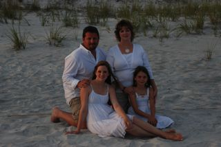

We hit the ground running when we got home on Sunday.

I immediately started mowing the yard, as it had been two weeks since it was mowed and I think it rained every day we were gone. I had a little trouble with the mower at first. It appeared that the fuel pump was not working, but after I worked on it a bit I found that it had lost it's prime. After that, it was just a battle to plow through the wet, thick grass. The yard looks horrible. I should have had a local farmer come over and bale it for hay. :)

We managed to get some great senior pictures of Stef and even some family photos of all of us. I'm not as pleased with the pictures of all four of us because I had to use the tripod and camera timer.

Here's a picture of Stef.

And here's one of all of us.

While we were gone, we took time to see the new Hulk movie. It's a winner! All of us liked it, even Becky.
